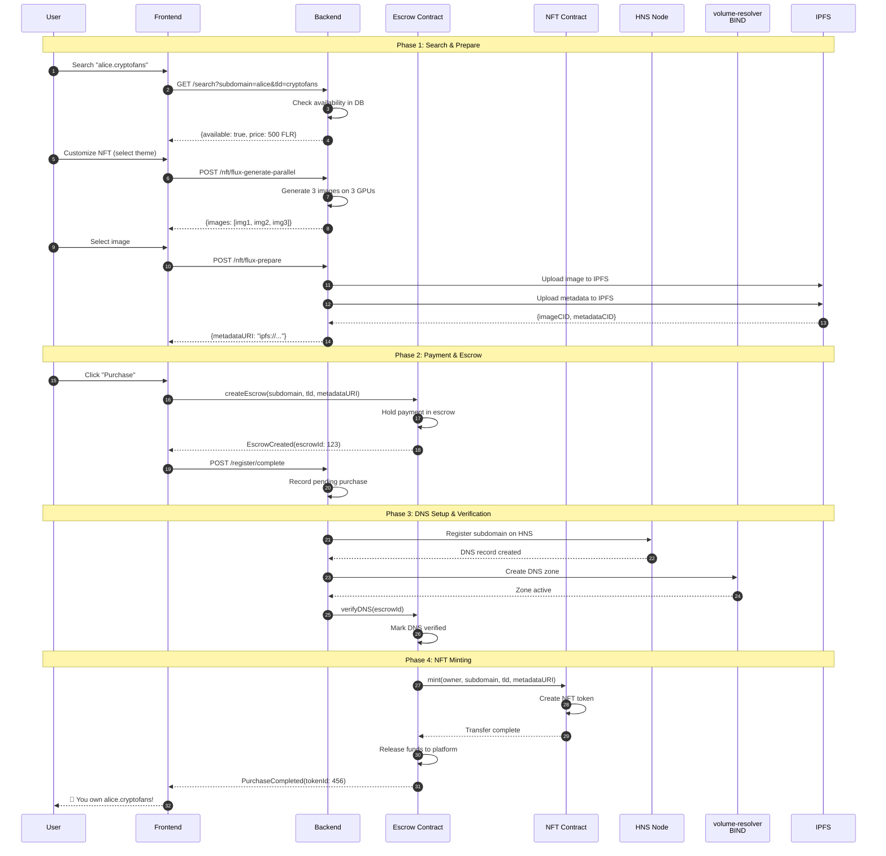
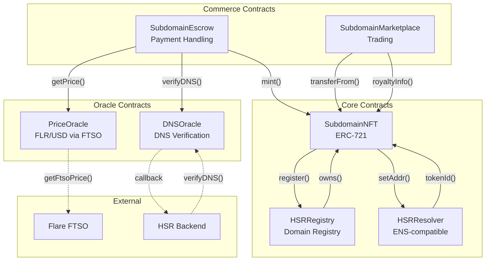
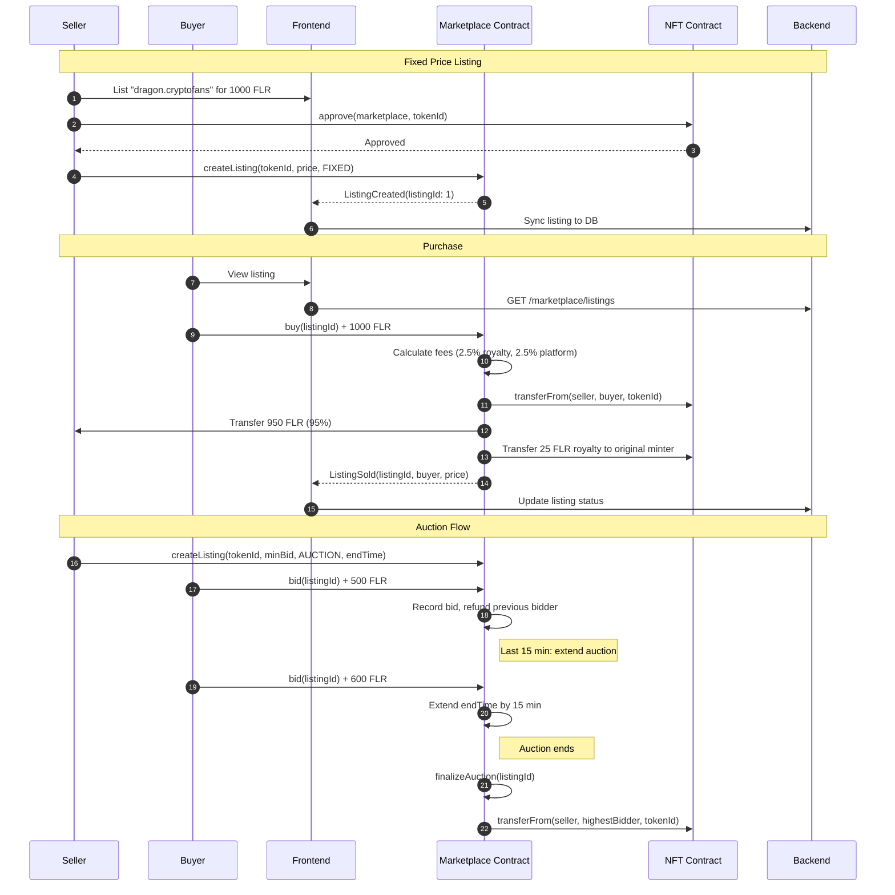
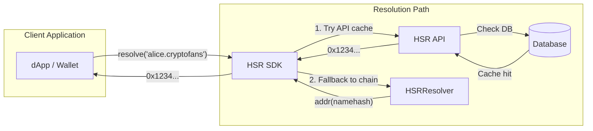
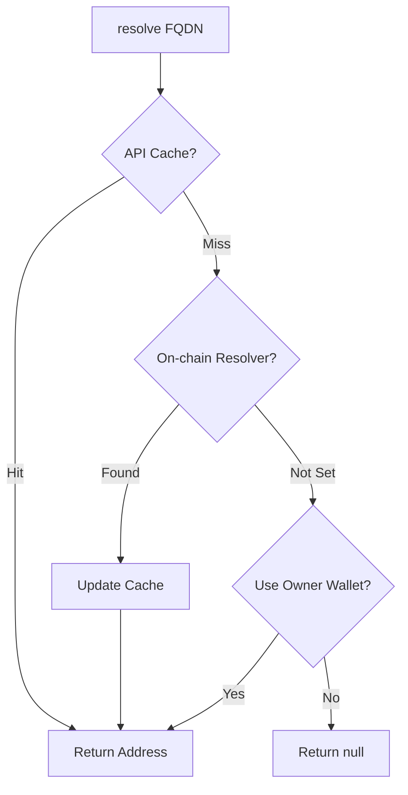
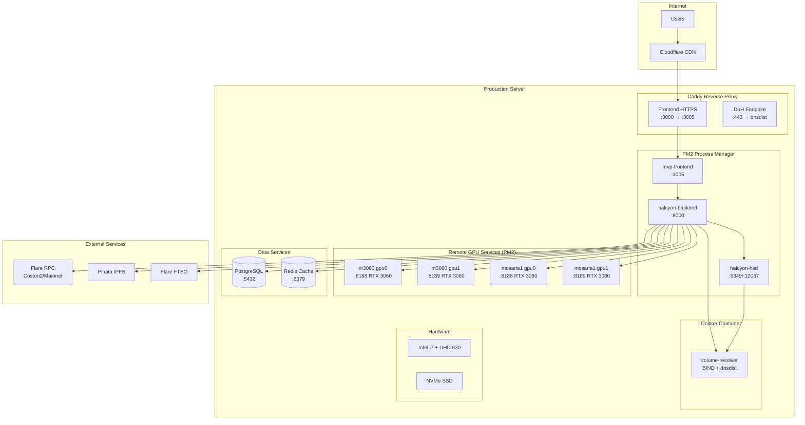
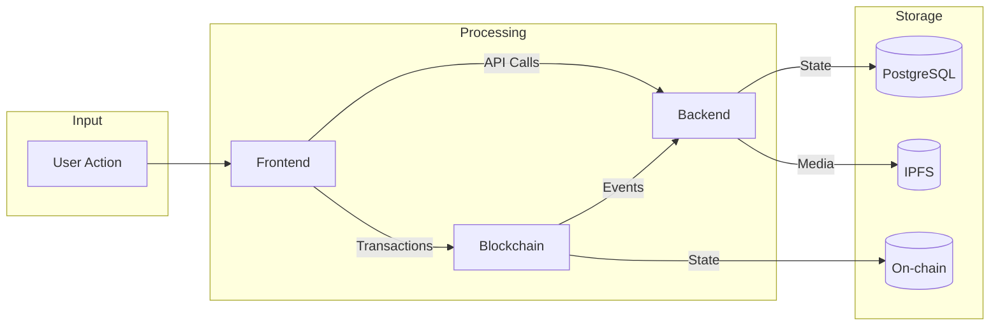
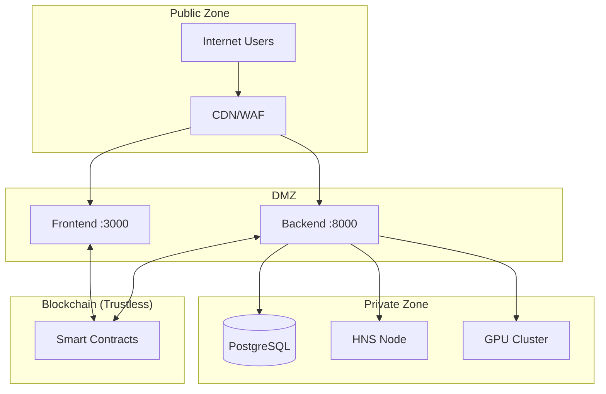

# HSR System Architecture

This document provides visual architecture diagrams for the Halcyon Subdomain Registry (HSR) system.

## Table of Contents

1. [System Overview](#system-overview)
2. [Component Architecture](#component-architecture)
3. [Registration Flow](#registration-flow)
4. [Smart Contract Architecture](#smart-contract-architecture)
5. [Marketplace Flow](#marketplace-flow)
6. [DNS Resolution Flow](#dns-resolution-flow)
7. [Image Generation Pipeline](#image-generation-pipeline)
8. [Deployment Topology](#deployment-topology)

---

## System Overview

High-level view of the HSR ecosystem showing all major components and their interactions.

```
┌──────────────────────────────────────────────────────────────────────────┐
│  USERS                                                                   │
│  Web Browser ──────► Frontend (Next.js)                                  │
│  Crypto Wallet ────► Web3Modal ──────────► Flare Network (direct tx)     │
└────────────────────────────┬─────────────────────────────────────────────┘
                             │ API calls
                             ▼
┌──────────────────────────────────────────────────────────────────────────┐
│  BACKEND (Node.js / Express)                                             │
│                                                                          │
│  REST API ─► Auth Middleware ─► Service Layer ─► PostgreSQL              │
│                                      │                                   │
│              ┌───────────┬───────────┼───────────┬───────────┐          │
│              ▼           ▼           ▼           ▼           ▼          │
│         Blockchain     DNS       Storage       GPUs      Events         │
└─────────────┬───────────┬───────────┬───────────┬───────────────────────┘
              │           │           │           │
              ▼           ▼           ▼           ▼
┌─────────────────┐ ┌──────────────┐ ┌─────────┐ ┌────────────────────────┐
│ FLARE (Coston2) │ │ DNS          │ │ STORAGE │ │ GPU CLUSTER            │
│                 │ │              │ │         │ │                        │
│ V1 Legacy (7)   │ │ volume-      │ │ IPFS /  │ │ m3060 (192.0.2.97)     │
│  NFT · Escrow   │ │ resolver     │ │ Pinata  │ │  RTX 3060 :8188       │
│  Marketplace    │ │ BIND 9.20    │ │         │ │  RTX 3060 :8189       │
│  Resolver       │ │ + dnsdist    │ │ Image   │ │                        │
│  Oracle · DNS   │ │              │ │ Cache   │ │ mosana1 (192.0.2.67)    │
│  Treasury       │ │ hsd          │ │         │ │  RTX 3080 :8188       │
│                 │ │ (Handshake   │ │         │ │  RTX 3080 :8189       │
│ V2 Staking (13) │ │  full node)  │ │         │ │                        │
│  HsrTld · HsrSld│ │              │ │         │ │ ComfyUI ×4 instances   │
│  ClaimManager   │ │ DoH endpoint │ │         │ │                        │
│  RegManager     │ │ dns.halcyon- │ │         │ │                        │
│  PaymentV2      │ │ names.io     │ │         │ │                        │
│  FtsoOracle     │ │              │ │         │ │                        │
│                 │ └──────────────┘ └─────────┘ └────────────────────────┘
│ FDC (Flare Data │
│  Connector)     │
│  TLD ownership  │
│  attestation    │
└─────────────────┘
```

---

## Component Architecture

Detailed view of the backend service architecture.

```mermaid
flowchart LR
    subgraph API["API Layer"]
        Routes[routes.js]
        Admin[adminRoutes.js]
    end

    subgraph Middleware["Middleware"]
        AuthMW[auth.js]
        Valid[validation.js]
        Audit[auditMiddleware.js]
        Logger[requestLogger.js]
    end

    subgraph Services["Service Layer"]
        HNS_Svc[hns.js<br/>Handshake]
        BIND_Svc[pdns.js<br/>BindZoneService]
        NFT_Svc[nft.js<br/>NFT Metadata]
        FTSO[ftso.js<br/>Price Oracle]
        Listener[contractListener.js<br/>V1 Events]
        StakingL[stakingListener.js<br/>V2 Events ×16]
        FDC[fdcKeeper.js<br/>FDC Attestations]
        Watcher[watcher.js<br/>DNS Propagation]
        PriceSync[priceSync.js<br/>On-chain Sync]
        FluxGPU[fluxMultiGPU.js<br/>Image Gen]
        ComfyMgr[comfyuiManager.js<br/>GPU Manager]
        ImgCache[imageCache.js<br/>Caching]
        Storage[nftStorage.js<br/>IPFS Upload]
        Ollama[ollama.js<br/>LLM Prompts]
    end

    subgraph Data["Data Layer"]
        Pool[(pg Pool)]
        Query[query()]
    end

    Routes --> AuthMW --> Valid --> Services
    Admin --> AuthMW --> Audit --> Services
    Services --> Query --> Pool

    HNS_Svc -.-> HNS_Node[HNS Node :12037/:5349]
    BIND_Svc -.-> BIND_Server[volume-resolver<br/>BIND :5300]
    FluxGPU -.-> ComfyUI_0[ComfyUI :8188]
    FluxGPU -.-> ComfyUI_1[ComfyUI :8189]
    FluxGPU -.-> ComfyUI_2[ComfyUI :8190]
    Storage -.-> Pinata[Pinata API]
    FTSO -.-> Flare[Flare RPC]
    Listener -.-> Flare
```

---

## Registration Flow

Complete domain registration process from search to NFT mint.



---

## Smart Contract Architecture

Relationships between HSR smart contracts.



### Contract Addresses (Coston2 Testnet)

#### V1 Legacy System (Hardhat)

| Contract | Address |
|----------|---------|
| SubdomainNFT | `0x900C2f2f9a89Cb62Af702611FF77c9F6Ef8dfd38` |
| SubdomainEscrow | `0xec53e23EFe752FcCaD57a2EF5ef535bABD605B4b` |
| SubdomainMarketplace | `0xa53e3f6feD1c16557c72aDcB357cbbD4acAF5B92` |
| HSRResolver | `0x7C0eA7094Be2caCB238D042b386B11ec24892Fb1` |
| PriceOracle | `0x55b92A8C367d408F028914BFCd48D1D4d16960b0` |
| DNSOracle | `0x218EB07c6ef92250DcfE0689a5309B10b96bA3Ff` |
| CommunityTreasury | `0xc87Bd36cdeBaa9C632e641F0865192b0DD67bAeD` |

#### V2 TLD Staking System (Foundry, Feb 2026)

| Contract | Address |
|----------|---------|
| HsrTld (ERC-721 UUPS) | `0xAEb64890BEBE39E5Fd845D95a81c818E9e039cdE` |
| HsrSld (ERC-721 UUPS) | `0xA94F9BB2877e969b63e78c148fdc66A61E415110` |
| TldClaimManager (UUPS) | `0xCfF939e85c53622fB6dCcD8FFc8d7408CB3E00c4` |
| SldRegistrationManager (UUPS) | `0x9e680e851492F6135320FDaf64030F1F0Eb35D69` |
| PaymentManagerV2 | `0x1137C7218b9e4c895F9A8C2ecaE5E1F4d96a7C2f` |
| FtsoOracle | `0x08d391c50AE8aa94B031195491Ffa9Df7953200c` |
| SldCommitIntent | `0x1EB1BDF49deF1A32a56Abcce348342bb52c8A91d` |
| DefaultRegistrationStrategy | `0xa42B21dA24734C6f5e24876D0FCcDB1299bC97fE` |
| LabelValidator | `0x5D13FA219deA785754043D63Cae2059b8AE1D213` |
| GlobalRegistrationRules | `0x9bdb1B85e81Ae4239EfdBe7c5e2071a0b6982e92` |
| DefaultResolver | `0xbE845B15524C31dAAe30b3C1004388BAEBE5Bc2F` |
| SldMetadataService | `0x0f9AEC25344239E1356A7966F8E05F281C5daFF5` |
| TldMetadataService | `0xa9C36F500BB6e0B5bC43aFe7160844387F9f8430` |

---

## Marketplace Flow

Domain listing, bidding, and sale process.



---

## DNS Resolution Flow

How HSR domains resolve to wallet addresses.



### Resolution Priority



---

## Image Generation Pipeline

Multi-GPU image generation flow for NFT artwork.

```mermaid
flowchart TB
    subgraph Request["User Request"]
        User[User selects 3 themes]
        Prompt[Custom prompt: "cosmic dragon"]
    end

    subgraph Backend["Backend Orchestration"]
        FluxSvc[fluxMultiGPU.js]
        Queue[Generation Queue]
    end

    subgraph GPUs["GPU Cluster (3x RTX 3060)"]
        subgraph GPU0["GPU 0 - Port 8188"]
            ComfyUI0[ComfyUI]
            Theme0[Theme: Cyberpunk]
        end
        subgraph GPU1["GPU 1 - Port 8189"]
            ComfyUI1[ComfyUI]
            Theme1[Theme: Fantasy]
        end
        subgraph GPU2["GPU 2 - Port 8190"]
            ComfyUI2[ComfyUI]
            Theme2[Theme: Abstract]
        end
    end

    subgraph Output["Output"]
        Images[3 Generated Images]
        Select[User Selects Best]
        IPFS[Upload to IPFS]
    end

    User --> FluxSvc
    Prompt --> FluxSvc
    FluxSvc --> Queue
    Queue -->|Parallel| GPU0 & GPU1 & GPU2
    GPU0 --> Images
    GPU1 --> Images
    GPU2 --> Images
    Images --> Select --> IPFS
```

### Generation Specs

| Parameter | Value |
|-----------|-------|
| Model | Flux 1 Schnell |
| Resolution | 1024x1024 |
| Steps | 4 (Schnell optimized) |
| Generation Time | ~8-12 seconds per image |
| Parallel Capacity | 3 images simultaneously |

---

## Deployment Topology

Production deployment architecture.



### PM2 Process List

```
┌──────────────────────┬─────────┬─────────┬──────────┬─────────────────────┐
│ name                 │ mode    │ status  │ port     │ notes               │
├──────────────────────┼─────────┼─────────┼──────────┼─────────────────────┤
│ halcyon-backend      │ fork    │ online  │ 8000     │ Node.js/Express     │
│ mvp-frontend         │ fork    │ online  │ 3005     │ Next.js (Caddy→3000)│
│ halcyon-hsd          │ fork    │ online  │ 5349     │ DNS + 12037 RPC     │
│ comfyui-gpu0         │ fork    │ online  │ 8188     │ m3060 RTX 3060      │
│ comfyui-gpu1         │ fork    │ online  │ 8189     │ m3060 RTX 3060      │
│ comfyui-gpu2         │ fork    │ online  │ 8188     │ mosana1 RTX 3080    │
│ comfyui-gpu3         │ fork    │ online  │ 8189     │ mosana1 RTX 3080    │
└──────────────────────┴─────────┴─────────┴──────────┴─────────────────────┘
```

### Port Reference

| Service | Port | Protocol | Notes |
|---------|------|----------|-------|
| Frontend (Caddy) | 3000 | HTTPS | `tls internal`, proxy to 3005 |
| Frontend (Next.js) | 3005 | HTTP | Internal only |
| Backend API | 8000 | HTTP | Express v1 + v2 routes |
| hsd (DNS) | 5349 | DNS | Handshake resolution |
| hsd (RPC) | 12037 | HTTP | Name lookups |
| PostgreSQL | 5432 | TCP | |
| Redis | 6379 | TCP | |
| ComfyUI (m3060 GPU0) | 8188 | HTTP | 192.0.2.97, RTX 3060 |
| ComfyUI (m3060 GPU1) | 8189 | HTTP | 192.0.2.97, RTX 3060 |
| ComfyUI (mosana1 GPU0) | 8188 | HTTP | 192.0.2.67, RTX 3080 |
| ComfyUI (mosana1 GPU1) | 8189 | HTTP | 192.0.2.67, RTX 3080 |
| volume-resolver (BIND) | 5300 | DNS | Docker container |
| volume-resolver (DoH) | 800 | HTTP | dnsdist, Docker container |
| Caddy (DoH) | 443 | HTTPS | dns.halcyon-names.io |
| DNS-JSON API | 8054 | HTTP | Python API service |

---

## Data Flow Summary



---

## Security Boundaries



### Security Controls

| Layer | Controls |
|-------|----------|
| CDN | DDoS protection, WAF, SSL termination |
| API | Rate limiting, CORS, Helmet.js, Input validation |
| Auth | Wallet signature verification, Nonce replay protection |
| Database | Connection pooling, Parameterized queries |
| Blockchain | On-chain access control, Escrow pattern |
