# HSR Database Documentation

**Database:** PostgreSQL 14+
**Connection:** Managed via `pg` Pool
**ORM:** None (raw SQL queries)

## Table of Contents

1. [Entity Relationship Diagram](#entity-relationship-diagram)
2. [Tables Reference](#tables-reference)
3. [Enum Types](#enum-types)
4. [Indexes](#indexes)
5. [Common Queries](#common-queries)
6. [Migration Guide](#migration-guide)
7. [Backup & Recovery](#backup--recovery)
8. [Seed Data](#seed-data)

---

## Entity Relationship Diagram

```mermaid
erDiagram
    tlds ||--o{ domains : "has many"
    tlds ||--o{ pending_purchases : "has many"
    domains ||--o| address_mappings : "has one"
    domains ||--o{ domain_text_records : "has many"
    domains ||--o{ resolution_audit : "has many"
    domains ||--o| marketplace_listings : "has one active"
    domains ||--o{ marketplace_offers : "has many"
    pending_purchases ||--o| dns_verifications : "has one"
    flux_generations ||--o{ flux_generation_images : "has 3"
    flux_generations ||--o| flux_nft_selections : "has one"

    tlds {
        serial id PK
        varchar name UK
        boolean is_active
        timestamp created_at
    }

    domains {
        serial id PK
        bigint token_id UK
        varchar subdomain
        integer tld_id FK
        varchar fqdn UK
        varchar owner_wallet
        varchar original_buyer
        numeric registration_price_flr
        numeric registration_price_usd
        timestamp registration_date
        timestamp expiration_date
        domain_status status
        varchar tier
        varchar metadata_uri
        boolean dns_active
        varchar nft_image_cid
        varchar nft_metadata_cid
        bigint nft_generation_seed
        varchar resolver_address
        varchar wallet_address
        varchar namehash
        timestamp created_at
        timestamp updated_at
    }

    pending_purchases {
        serial id PK
        bigint escrow_id UK
        varchar wallet_address
        varchar subdomain
        integer tld_id FK
        varchar fqdn
        numeric price_flr
        numeric price_usd
        varchar escrow_tx_hash
        bigint token_id
        escrow_status status
        timestamp created_at
        timestamp dns_verified_at
        timestamp completed_at
        timestamp timeout_at
    }

    dns_verifications {
        serial id PK
        integer purchase_id FK
        varchar hns_block_hash
        bigint hns_block_height
        varchar hns_tx_hash
        jsonb dns_records
        timestamp verified_at
    }

    address_mappings {
        serial id PK
        integer domain_id FK
        bigint token_id
        varchar fqdn
        varchar namehash UK
        varchar wallet_address
        bigint coin_type
        timestamp updated_at
        varchar updated_by
        varchar tx_hash
    }

    domain_text_records {
        serial id PK
        integer domain_id FK
        varchar namehash
        varchar record_key
        text record_value
        timestamp updated_at
    }

    marketplace_listings {
        serial id PK
        bigint listing_id UK
        bigint token_id
        integer domain_id FK
        varchar fqdn
        varchar seller_wallet
        numeric price
        listing_type listing_type
        listing_status status
        timestamp end_time
        varchar highest_bidder
        numeric highest_bid
        varchar buyer_wallet
        numeric sale_price
        numeric royalty_amount
        numeric platform_fee
        varchar tx_hash
        bigint block_number
        timestamp created_at
        timestamp sold_at
        timestamp cancelled_at
    }

    marketplace_offers {
        serial id PK
        bigint offer_id UK
        bigint token_id
        integer domain_id FK
        varchar fqdn
        varchar offerer_wallet
        numeric amount
        timestamp expires_at
        boolean is_accepted
        boolean is_cancelled
        varchar accepted_by
        varchar tx_hash
        bigint block_number
        timestamp created_at
    }

    flux_generations {
        serial id PK
        uuid generation_id UK
        varchar wallet_address
        varchar fqdn
        varchar custom_prompt
        flux_generation_status status
        timestamp started_at
        timestamp completed_at
        numeric total_time_seconds
        integer success_count
        timestamp created_at
    }

    flux_generation_images {
        serial id PK
        uuid generation_id FK
        integer image_index
        varchar theme_id
        varchar theme_name
        varchar theme_category
        bigint seed
        varchar status
        varchar server_name
        numeric generation_time_seconds
        varchar image_cid
        text image_base64
        text error_message
        timestamp created_at
    }

    audit_log {
        serial id PK
        varchar action
        varchar entity_type
        varchar entity_id
        varchar actor_wallet
        jsonb details
        timestamp created_at
    }

    user_favorites {
        serial id PK
        varchar wallet_address
        varchar theme_id
        varchar style_id
        timestamp created_at
    }

    tlds_v2 ||--o{ slds_v2 : "has many"
    tlds_v2 ||--o| tld_pricing_v2 : "has pricing"
    tlds_v2 ||--o{ premium_names_v2 : "has premiums"
    tlds_v2 ||--o{ reserved_names_v2 : "has reserved"
    slds_v2 ||--o| sld_artwork_v2 : "has artwork"
    slds_v2 ||--o{ registration_events_v2 : "has events"

    tlds_v2 {
        serial id PK
        varchar label UK
        varchar namehash UK
        varchar owner_address
        boolean registration_enabled
        boolean is_official
        timestamp staked_at
    }

    slds_v2 {
        serial id PK
        integer tld_id FK
        varchar label
        varchar full_name UK
        varchar owner_address
        timestamp expiry_time
        boolean active
    }

    tld_pricing_v2 {
        integer tld_id PK
        jsonb length_prices
        jsonb multi_year_discounts
    }

    sld_artwork_v2 {
        serial id PK
        integer sld_id FK
        varchar art_style
        varchar ipfs_cid_image
        varchar ipfs_cid_metadata
    }

    registration_events_v2 {
        serial id PK
        integer sld_id FK
        varchar event_type
        varchar tx_hash
        bigint block_number
    }
```



---

## Tables Reference

### Core Domain Tables

#### `tlds`
Top-Level Domains available for registration.

| Column | Type | Constraints | Description |
|--------|------|-------------|-------------|
| id | SERIAL | PRIMARY KEY | Auto-increment ID |
| name | VARCHAR(63) | UNIQUE, NOT NULL | TLD name (e.g., "cryptofans") |
| is_active | BOOLEAN | DEFAULT true | Whether TLD is available |
| created_at | TIMESTAMP | DEFAULT NOW() | Creation timestamp |

#### `domains`
Main domain registry - one row per registered subdomain.

| Column | Type | Constraints | Description |
|--------|------|-------------|-------------|
| id | SERIAL | PRIMARY KEY | Auto-increment ID |
| token_id | BIGINT | UNIQUE | NFT token ID on-chain |
| subdomain | VARCHAR(63) | NOT NULL | Subdomain part (e.g., "alice") |
| tld_id | INTEGER | FK → tlds(id) | Reference to TLD |
| fqdn | VARCHAR(255) | UNIQUE, NOT NULL | Full domain (e.g., "alice.cryptofans") |
| owner_wallet | VARCHAR(42) | NOT NULL | Current owner wallet |
| original_buyer | VARCHAR(42) | NOT NULL | First registrant wallet |
| registration_price_flr | NUMERIC(36,18) | | Price paid in FLR |
| registration_price_usd | NUMERIC(18,2) | | Price in USD at time |
| registration_date | TIMESTAMP | NOT NULL | When registered |
| expiration_date | TIMESTAMP | | When domain expires |
| status | domain_status | DEFAULT 'active' | Domain status |
| tier | VARCHAR(20) | | Pricing tier |
| metadata_uri | VARCHAR(500) | | IPFS metadata URI |
| dns_active | BOOLEAN | DEFAULT false | DNS records configured |
| nft_image_cid | VARCHAR(100) | | IPFS CID for NFT image |
| nft_metadata_cid | VARCHAR(100) | | IPFS CID for metadata |
| nft_generation_seed | BIGINT | | Seed used for AI generation |
| resolver_address | VARCHAR(42) | | On-chain resolver contract |
| wallet_address | VARCHAR(42) | | Resolved wallet address |
| namehash | VARCHAR(66) | | ENS-style namehash |
| created_at | TIMESTAMP | DEFAULT NOW() | Record creation |
| updated_at | TIMESTAMP | DEFAULT NOW() | Last update |

### Escrow & Purchase Tables

#### `pending_purchases`
Tracks purchases in escrow awaiting DNS verification.

| Column | Type | Constraints | Description |
|--------|------|-------------|-------------|
| id | SERIAL | PRIMARY KEY | Auto-increment ID |
| escrow_id | BIGINT | UNIQUE | On-chain escrow ID |
| wallet_address | VARCHAR(42) | NOT NULL | Buyer wallet |
| subdomain | VARCHAR(63) | NOT NULL | Subdomain being purchased |
| tld_id | INTEGER | FK → tlds(id) | Reference to TLD |
| fqdn | VARCHAR(255) | NOT NULL | Full domain name |
| price_flr | NUMERIC(36,18) | NOT NULL | Price in FLR |
| price_usd | NUMERIC(18,2) | | Price in USD |
| escrow_tx_hash | VARCHAR(66) | | Escrow transaction hash |
| token_id | BIGINT | | Minted token ID (after completion) |
| status | escrow_status | DEFAULT 'pending' | Escrow status |
| created_at | TIMESTAMP | DEFAULT NOW() | Purchase initiated |
| dns_verified_at | TIMESTAMP | | When DNS was verified |
| completed_at | TIMESTAMP | | When purchase completed |
| timeout_at | TIMESTAMP | | Escrow timeout deadline |

#### `dns_verifications`
DNS verification records for purchases.

| Column | Type | Description |
|--------|------|-------------|
| id | SERIAL | Primary key |
| purchase_id | INTEGER | FK → pending_purchases(id) |
| hns_block_hash | VARCHAR(66) | HNS block containing verification |
| hns_block_height | BIGINT | HNS block height |
| hns_tx_hash | VARCHAR(66) | HNS transaction hash |
| dns_records | JSONB | Verified DNS records |
| verified_at | TIMESTAMP | Verification timestamp |

### Address Resolution Tables

#### `address_mappings`
Maps domain namehashes to wallet addresses (mirrors on-chain resolver).

| Column | Type | Constraints | Description |
|--------|------|-------------|-------------|
| id | SERIAL | PRIMARY KEY | Auto-increment ID |
| domain_id | INTEGER | FK → domains(id) | Reference to domain |
| token_id | BIGINT | NOT NULL | NFT token ID |
| fqdn | VARCHAR(255) | NOT NULL | Full domain name |
| namehash | VARCHAR(66) | UNIQUE with coin_type | ENS-style namehash |
| wallet_address | VARCHAR(42) | | Resolved address |
| coin_type | BIGINT | DEFAULT 2147483662 | COINTYPE_FLR |
| updated_at | TIMESTAMP | | Last update |
| updated_by | VARCHAR(42) | | Who updated |
| tx_hash | VARCHAR(66) | | Update transaction |

#### `domain_text_records`
ENS-compatible text records (avatar, url, description, etc.).

| Column | Type | Constraints | Description |
|--------|------|-------------|-------------|
| id | SERIAL | PRIMARY KEY | Auto-increment ID |
| domain_id | INTEGER | FK → domains(id) | Reference to domain |
| namehash | VARCHAR(66) | UNIQUE with record_key | Domain namehash |
| record_key | VARCHAR(100) | NOT NULL | Record key (e.g., "avatar") |
| record_value | TEXT | | Record value |
| updated_at | TIMESTAMP | | Last update |

### Marketplace Tables

#### `marketplace_listings`
Active and historical marketplace listings.

| Column | Type | Constraints | Description |
|--------|------|-------------|-------------|
| id | SERIAL | PRIMARY KEY | Auto-increment ID |
| listing_id | BIGINT | UNIQUE, NOT NULL | On-chain listing ID |
| token_id | BIGINT | NOT NULL | NFT token ID |
| domain_id | INTEGER | FK → domains(id) | Reference to domain |
| fqdn | VARCHAR(255) | | Full domain name |
| seller_wallet | VARCHAR(42) | NOT NULL | Seller address |
| price | NUMERIC(36,18) | NOT NULL | Listing price in FLR |
| listing_type | listing_type | DEFAULT 'fixed_price' | fixed_price or auction |
| status | listing_status | DEFAULT 'active' | active, sold, cancelled |
| end_time | TIMESTAMP | | Auction end time |
| highest_bidder | VARCHAR(42) | | Current high bidder |
| highest_bid | NUMERIC(36,18) | | Current high bid |
| buyer_wallet | VARCHAR(42) | | Final buyer (when sold) |
| sale_price | NUMERIC(36,18) | | Final sale price |
| royalty_amount | NUMERIC(36,18) | | Royalty paid |
| platform_fee | NUMERIC(36,18) | | Platform fee |
| tx_hash | VARCHAR(66) | | Transaction hash |
| block_number | BIGINT | | Block number |
| created_at | TIMESTAMP | | Listing created |
| sold_at | TIMESTAMP | | When sold |
| cancelled_at | TIMESTAMP | | When cancelled |

#### `marketplace_offers`
Offers on domains.

| Column | Type | Description |
|--------|------|-------------|
| id | SERIAL | Primary key |
| offer_id | BIGINT | On-chain offer ID |
| token_id | BIGINT | NFT token ID |
| domain_id | INTEGER | FK → domains(id) |
| fqdn | VARCHAR(255) | Full domain name |
| offerer_wallet | VARCHAR(42) | Who made offer |
| amount | NUMERIC(36,18) | Offer amount |
| expires_at | TIMESTAMP | Offer expiration |
| is_accepted | BOOLEAN | Whether accepted |
| is_cancelled | BOOLEAN | Whether cancelled |
| accepted_by | VARCHAR(42) | Who accepted |
| tx_hash | VARCHAR(66) | Transaction hash |
| block_number | BIGINT | Block number |
| created_at | TIMESTAMP | Offer created |

#### `marketplace_activity`
All marketplace events for history/analytics.

| Column | Type | Description |
|--------|------|-------------|
| id | SERIAL | Primary key |
| event_type | VARCHAR(50) | Event type (listed, sold, bid, etc.) |
| listing_id | BIGINT | Related listing |
| offer_id | BIGINT | Related offer |
| token_id | BIGINT | NFT token ID |
| fqdn | VARCHAR(255) | Full domain name |
| actor_wallet | VARCHAR(42) | Who performed action |
| counterparty_wallet | VARCHAR(42) | Other party |
| amount | NUMERIC(36,18) | Amount involved |
| tx_hash | VARCHAR(66) | Transaction hash |
| block_number | BIGINT | Block number |
| created_at | TIMESTAMP | Event timestamp |

### NFT Generation Tables

#### `flux_generations`
Multi-GPU image generation jobs.

| Column | Type | Description |
|--------|------|-------------|
| id | SERIAL | Primary key |
| generation_id | UUID | Unique generation ID |
| wallet_address | VARCHAR(42) | Requesting wallet |
| fqdn | VARCHAR(255) | Domain being generated for |
| custom_prompt | VARCHAR(500) | User's custom prompt |
| status | flux_generation_status | pending, generating, completed, failed |
| started_at | TIMESTAMP | Generation started |
| completed_at | TIMESTAMP | Generation completed |
| total_time_seconds | NUMERIC(10,2) | Total generation time |
| success_count | INTEGER | Successful images (0-3) |
| created_at | TIMESTAMP | Record created |

#### `flux_generation_images`
Individual images (3 per generation).

| Column | Type | Description |
|--------|------|-------------|
| id | SERIAL | Primary key |
| generation_id | UUID | FK → flux_generations |
| image_index | INTEGER | 0, 1, or 2 |
| theme_id | VARCHAR(50) | Theme used |
| theme_name | VARCHAR(100) | Theme display name |
| theme_category | VARCHAR(20) | Theme category |
| seed | BIGINT | Generation seed |
| status | VARCHAR(20) | Image status |
| server_name | VARCHAR(20) | GPU server used |
| generation_time_seconds | NUMERIC(10,2) | Time to generate |
| image_cid | VARCHAR(100) | IPFS CID (if uploaded) |
| image_base64 | TEXT | Base64 image data |
| error_message | TEXT | Error if failed |
| created_at | TIMESTAMP | Created timestamp |

#### `nft_preparations`
Prepared NFT data before purchase.

| Column | Type | Description |
|--------|------|-------------|
| id | SERIAL | Primary key |
| fqdn | VARCHAR(255) | Full domain name (unique) |
| subdomain | VARCHAR(63) | Subdomain |
| tld | VARCHAR(63) | TLD |
| image_cid | VARCHAR(100) | IPFS image CID |
| metadata_cid | VARCHAR(100) | IPFS metadata CID |
| generation_seed | BIGINT | Seed used |
| tier | VARCHAR(20) | Pricing tier |
| theme | VARCHAR(50) | Theme used |
| custom_prompt | VARCHAR(200) | Custom prompt |
| created_at | TIMESTAMP | Created timestamp |

### Credits & Authentication Tables

#### `regeneration_credits`
Tracks regeneration credits per wallet.

| Column | Type | Default | Description |
|--------|------|---------|-------------|
| wallet_address | VARCHAR(42) | PK | Wallet address |
| free_remaining | INTEGER | 10 | Free credits left |
| paid_credits | INTEGER | 0 | Purchased credits |
| total_regenerations | INTEGER | 0 | Total regens done |
| updated_at | TIMESTAMP | NOW() | Last update |

#### `preview_credits`
Preview generation credits (10 free per wallet).

| Column | Type | Default | Description |
|--------|------|---------|-------------|
| wallet_address | VARCHAR(42) | PK | Wallet address |
| used_count | INTEGER | 0 | Credits used |
| created_at | TIMESTAMP | NOW() | First use |
| updated_at | TIMESTAMP | NOW() | Last update |

#### `auth_nonces`
Authentication nonces (prevent replay attacks).

| Column | Type | Description |
|--------|------|-------------|
| wallet_address | VARCHAR(42) | PK - Wallet address |
| nonce | VARCHAR(100) | Current nonce |
| expires_at | TIMESTAMP | Nonce expiration |
| created_at | TIMESTAMP | Created timestamp |

### System Tables

#### `processed_events`
Blockchain events already processed (prevents duplicates).

| Column | Type | Constraints | Description |
|--------|------|-------------|-------------|
| id | SERIAL | PRIMARY KEY | Auto-increment ID |
| event_type | VARCHAR(50) | NOT NULL | Event type |
| tx_hash | VARCHAR(66) | UNIQUE with log_index | Transaction hash |
| block_number | BIGINT | NOT NULL | Block number |
| log_index | INTEGER | NOT NULL | Log index |
| processed_at | TIMESTAMP | DEFAULT NOW() | When processed |
| data | JSONB | | Event data |

#### `watcher_state`
Persistent state for block scanner.

| Column | Type | Description |
|--------|------|-------------|
| key | VARCHAR(50) | PK - State key |
| value | TEXT | State value |
| updated_at | TIMESTAMP | Last update |

#### `audit_log`
Admin action audit trail.

| Column | Type | Description |
|--------|------|-------------|
| id | SERIAL | Primary key |
| action | VARCHAR(50) | Action performed |
| entity_type | VARCHAR(50) | Entity type affected |
| entity_id | VARCHAR(100) | Entity identifier |
| actor_wallet | VARCHAR(42) | Who performed action |
| details | JSONB | Additional details |
| created_at | TIMESTAMP | When performed |

### V2 TLD Staking Tables (Added Feb 2026)

#### `tlds_v2`
TLD registry mirroring on-chain HsrTld contract.

| Column | Type | Constraints | Description |
|--------|------|-------------|-------------|
| id | SERIAL | PRIMARY KEY | Auto-increment ID |
| label | VARCHAR(63) | UNIQUE, NOT NULL | TLD name (e.g., "cryptofans") |
| namehash | VARCHAR(66) | UNIQUE | ENS-style namehash |
| owner_address | VARCHAR(42) | NOT NULL | Staker's Flare wallet |
| registration_enabled | BOOLEAN | DEFAULT false | Whether SLD registration is open |
| is_official | BOOLEAN | DEFAULT false | Platform-verified TLD |
| staked_at | TIMESTAMP | | When TLD was staked |
| display_name | VARCHAR(100) | | Human-readable display name |
| description | TEXT | | TLD description |
| logo_url | VARCHAR(500) | | Logo image URL |

#### `slds_v2`
SLD/subdomain registry mirroring on-chain HsrSld contract.

| Column | Type | Constraints | Description |
|--------|------|-------------|-------------|
| id | SERIAL | PRIMARY KEY | Auto-increment ID |
| tld_id | INTEGER | FK → tlds_v2(id) | Reference to TLD |
| label | VARCHAR(63) | NOT NULL | Subdomain part |
| full_name | VARCHAR(255) | UNIQUE, NOT NULL | Full domain (label.tld) |
| owner_address | VARCHAR(42) | NOT NULL | Current owner wallet |
| created_at | TIMESTAMP | DEFAULT NOW() | Registration time |
| expiry_time | TIMESTAMP | NOT NULL | When domain expires |
| renewal_price_usd | NUMERIC(18,2) | | Renewal price in USD |
| active | BOOLEAN | DEFAULT true | Whether domain is active |

#### `sld_artwork_v2`
Artwork metadata for V2 SLDs.

| Column | Type | Description |
|--------|------|-------------|
| id | SERIAL | Primary key |
| sld_id | INTEGER | FK → slds_v2(id) |
| art_style | VARCHAR(50) | Art style used |
| theme | VARCHAR(50) | Theme category |
| ipfs_cid_image | VARCHAR(100) | IPFS CID for image |
| ipfs_cid_metadata | VARCHAR(100) | IPFS CID for metadata |
| generated_at | TIMESTAMP | When artwork was generated |
| artist_address | VARCHAR(42) | Artist wallet (if custom) |

#### `tld_pricing_v2`
Dynamic pricing configuration per TLD.

| Column | Type | Description |
|--------|------|-------------|
| tld_id | INTEGER | FK → tlds_v2(id), PK |
| length_prices | JSONB | Price tiers by label length |
| multi_year_discounts | JSONB | Discount percentages by year count |

#### `premium_names_v2`
Reserved premium subdomain names with custom pricing.

| Column | Type | Description |
|--------|------|-------------|
| id | SERIAL | Primary key |
| tld_id | INTEGER | FK → tlds_v2(id) |
| label | VARCHAR(63) | Premium name |
| price_usd | NUMERIC(18,2) | Custom price in USD |

#### `reserved_names_v2`
Permanently reserved names that cannot be registered.

| Column | Type | Description |
|--------|------|-------------|
| id | SERIAL | Primary key |
| tld_id | INTEGER | FK → tlds_v2(id) |
| label | VARCHAR(63) | Reserved name |

#### `pending_claims`
In-flight TLD staking sessions awaiting FDC attestation.

| Column | Type | Description |
|--------|------|-------------|
| id | SERIAL | Primary key |
| sld_id | INTEGER | FK → slds_v2(id) |
| session_id | VARCHAR(100) | Unique session identifier |
| status | VARCHAR(20) | pending, completed, expired |
| initiated_at | TIMESTAMP | When claim started |
| expires_at | TIMESTAMP | Session expiration |
| tx_hash | VARCHAR(66) | On-chain transaction hash |

#### `registration_events_v2`
Event log for all V2 registrations and staking actions.

| Column | Type | Description |
|--------|------|-------------|
| id | SERIAL | Primary key |
| sld_id | INTEGER | FK → slds_v2(id) |
| event_type | VARCHAR(50) | Event type (registered, renewed, transferred, etc.) |
| tx_hash | VARCHAR(66) | Transaction hash |
| block_number | BIGINT | Block number |
| block_timestamp | TIMESTAMP | Block timestamp |

---

## Enum Types

### `escrow_status`
```sql
CREATE TYPE escrow_status AS ENUM (
  'pending',       -- Awaiting DNS verification
  'dns_verified',  -- DNS verified, awaiting completion
  'completed',     -- Purchase complete, NFT minted
  'refunded',      -- Refunded to buyer
  'expired'        -- Escrow timed out
);
```

### `domain_status`
```sql
CREATE TYPE domain_status AS ENUM (
  'active',         -- Domain is active
  'expiring_soon',  -- Expiring within 90 days
  'expired',        -- Past expiration + grace period
  'grace_period',   -- In 60-day grace period (owner can renew at 50%)
  'reclaimed'       -- Reclaimed by treasury after grace period
);
```

### `listing_type`
```sql
CREATE TYPE listing_type AS ENUM (
  'fixed_price',  -- Fixed price listing
  'auction'       -- Auction listing
);
```

### `listing_status`
```sql
CREATE TYPE listing_status AS ENUM (
  'active',     -- Currently listed
  'sold',       -- Sold
  'cancelled'   -- Cancelled by seller
);
```

### `flux_generation_status`
```sql
CREATE TYPE flux_generation_status AS ENUM (
  'pending',     -- Queued for generation
  'generating',  -- Currently generating
  'completed',   -- All images generated
  'failed'       -- Generation failed
);
```

---

## Indexes

### Existing Indexes

```sql
-- Domain lookups
CREATE INDEX idx_domains_owner ON domains(owner_wallet);
CREATE INDEX idx_domains_fqdn ON domains(fqdn);
CREATE INDEX idx_domains_status ON domains(status);
CREATE INDEX idx_domains_wallet_address ON domains(wallet_address);
CREATE INDEX idx_domains_namehash ON domains(namehash);

-- Pending purchases
CREATE INDEX idx_pending_status ON pending_purchases(status);
CREATE INDEX idx_pending_wallet ON pending_purchases(wallet_address);

-- Blockchain events
CREATE INDEX idx_events_block ON processed_events(block_number);

-- Audit log (comprehensive)
CREATE INDEX idx_audit_log_created ON audit_log(created_at DESC);
CREATE INDEX idx_audit_log_action ON audit_log(action);
CREATE INDEX idx_audit_log_entity_type ON audit_log(entity_type);
CREATE INDEX idx_audit_log_actor ON audit_log(actor_wallet);
CREATE INDEX idx_audit_log_action_created ON audit_log(action, created_at DESC);
CREATE INDEX idx_audit_log_entity_type_created ON audit_log(entity_type, created_at DESC);

-- Authentication
CREATE INDEX idx_auth_nonces_expires ON auth_nonces(expires_at);

-- NFT preparations
CREATE INDEX idx_nft_prep_fqdn ON nft_preparations(fqdn);
CREATE INDEX idx_nft_prep_created ON nft_preparations(created_at);

-- Credits
CREATE INDEX idx_regen_credits_wallet ON regeneration_credits(wallet_address);
CREATE INDEX idx_used_credit_tx_hash ON used_credit_transactions(tx_hash);
CREATE INDEX idx_used_credit_wallet ON used_credit_transactions(wallet);

-- Address resolution
CREATE INDEX idx_address_mappings_namehash ON address_mappings(namehash);
CREATE INDEX idx_address_mappings_fqdn ON address_mappings(fqdn);
CREATE INDEX idx_address_mappings_wallet ON address_mappings(wallet_address);
CREATE INDEX idx_text_records_namehash ON domain_text_records(namehash);

-- Marketplace (optimized)
CREATE INDEX idx_listings_token ON marketplace_listings(token_id);
CREATE INDEX idx_listings_seller ON marketplace_listings(seller_wallet);
CREATE INDEX idx_listings_status ON marketplace_listings(status);
CREATE INDEX idx_listings_fqdn ON marketplace_listings(fqdn);
CREATE INDEX idx_listings_active_created ON marketplace_listings(status, created_at DESC)
  WHERE status = 'active';
CREATE INDEX idx_listings_active_price ON marketplace_listings(status, price)
  WHERE status = 'active';
CREATE INDEX idx_listings_status_sold_at ON marketplace_listings(status, sold_at DESC)
  WHERE status = 'sold';
CREATE INDEX idx_offers_token ON marketplace_offers(token_id);
CREATE INDEX idx_offers_offerer ON marketplace_offers(offerer_wallet);
CREATE INDEX idx_activity_token ON marketplace_activity(token_id);
CREATE INDEX idx_activity_type ON marketplace_activity(event_type);

-- Flux generation
CREATE INDEX idx_flux_gen_wallet ON flux_generations(wallet_address);
CREATE INDEX idx_flux_gen_fqdn ON flux_generations(fqdn);
CREATE INDEX idx_flux_gen_status ON flux_generations(status);
CREATE INDEX idx_flux_gen_created ON flux_generations(created_at);
CREATE INDEX idx_flux_images_gen_id ON flux_generation_images(generation_id);
CREATE INDEX idx_flux_selections_gen_id ON flux_nft_selections(generation_id);

-- Favorites & sharing
CREATE INDEX idx_favorites_wallet ON user_favorites(wallet_address);
CREATE INDEX idx_favorites_theme ON user_favorites(theme_id);
CREATE INDEX idx_favorites_style ON user_favorites(style_id);
CREATE INDEX idx_shared_images_share_id ON shared_images(share_id);
CREATE INDEX idx_shared_images_wallet ON shared_images(wallet_address);
```

### Recommended Additional Indexes

```sql
-- For domain expiration queries
CREATE INDEX idx_domains_expiration ON domains(expiration_date)
  WHERE status IN ('active', 'expiring_soon');

-- For TLD-specific domain counts
CREATE INDEX idx_domains_tld_status ON domains(tld_id, status);

-- For marketplace floor price queries
CREATE INDEX idx_listings_tld_price ON marketplace_listings(fqdn, price)
  WHERE status = 'active';

-- For recent registrations
CREATE INDEX idx_domains_registration_date ON domains(registration_date DESC);

-- For pending escrow timeout cleanup
CREATE INDEX idx_pending_timeout ON pending_purchases(timeout_at)
  WHERE status = 'pending';
```

---

## Common Queries

### Get Domain by FQDN
```sql
SELECT d.*, t.name as tld_name
FROM domains d
JOIN tlds t ON d.tld_id = t.id
WHERE d.fqdn = $1;
```

### Get Domains by Owner
```sql
SELECT d.*, t.name as tld_name
FROM domains d
JOIN tlds t ON d.tld_id = t.id
WHERE d.owner_wallet = $1
ORDER BY d.registration_date DESC;
```

### Get Active Marketplace Listings (Paginated)
```sql
SELECT ml.*, d.subdomain, t.name as tld_name
FROM marketplace_listings ml
JOIN domains d ON ml.domain_id = d.id
JOIN tlds t ON d.tld_id = t.id
WHERE ml.status = 'active'
ORDER BY ml.created_at DESC
LIMIT $1 OFFSET $2;
```

### Get Recent Sales
```sql
SELECT ml.*, d.subdomain, t.name as tld_name
FROM marketplace_listings ml
JOIN domains d ON ml.domain_id = d.id
JOIN tlds t ON d.tld_id = t.id
WHERE ml.status = 'sold'
ORDER BY ml.sold_at DESC
LIMIT $1;
```

### Resolve Domain to Address
```sql
SELECT am.wallet_address, d.fqdn, d.token_id
FROM address_mappings am
JOIN domains d ON am.domain_id = d.id
WHERE am.namehash = $1 AND am.coin_type = 2147483662;
```

### Get Marketplace Stats
```sql
SELECT
  COUNT(*) FILTER (WHERE status = 'active') as active_listings,
  COUNT(*) FILTER (WHERE status = 'sold') as total_sales,
  SUM(sale_price) FILTER (WHERE status = 'sold') as total_volume,
  SUM(sale_price) FILTER (WHERE status = 'sold' AND sold_at > NOW() - INTERVAL '24 hours') as volume_24h,
  MIN(price) FILTER (WHERE status = 'active') as floor_price
FROM marketplace_listings;
```

---

## Migration Guide

### Running Migrations

Migrations are idempotent and can be run multiple times safely.

```bash
# From backend directory
cd /home/localai/Desktop/HSR/backend

# Run migrations
node src/db/migrate.js

# Or via npm script (if configured)
npm run migrate
```

### Migration Philosophy

1. **Idempotent**: All `CREATE TABLE` uses `IF NOT EXISTS`
2. **Safe Column Adds**: Uses `ALTER TABLE ADD COLUMN IF NOT EXISTS`
3. **Safe Enum Creation**: Wrapped in `DO $$ BEGIN ... EXCEPTION ... END $$`
4. **Data Preservation**: Migrations never drop data

### Adding New Migrations

Edit `src/db/migrate.js` and add new SQL at the end of the `migrations` string:

```javascript
const migrations = `
  -- Existing migrations...

  -- New migration (2024-01-27)
  ALTER TABLE domains ADD COLUMN IF NOT EXISTS new_column VARCHAR(100);
  CREATE INDEX IF NOT EXISTS idx_domains_new_column ON domains(new_column);
`;
```

### Schema Changes Checklist

- [ ] Add column with `IF NOT EXISTS`
- [ ] Add default value for existing rows
- [ ] Create necessary indexes
- [ ] Update relevant queries in code
- [ ] Test migration locally
- [ ] Test rollback procedure

---

## Backup & Recovery

### Automated Backups

```bash
# Daily backup (run via cron)
/home/localai/Desktop/HSR/backend/scripts/backup/backup.sh --verify

# Cron entry (2 AM daily)
0 2 * * * /home/localai/Desktop/HSR/backend/scripts/backup/backup.sh --verify
```

### Manual Backup

```bash
pg_dump -h localhost -U hsr_user -d hsr_db -F c -f backup_$(date +%Y%m%d).dump
```

### Restore

```bash
# Test restore (to separate database)
./scripts/backup/restore.sh --test latest

# Production restore
./scripts/backup/restore.sh latest
```

### Full Documentation

See: [DISASTER_RECOVERY.md](../backend/scripts/backup/DISASTER_RECOVERY.md)

---

## Seed Data

### Seed Script

Create `/backend/scripts/seed.js`:

```javascript
import pool from '../src/db/index.js';

const seedData = async () => {
  console.log('Seeding database...');

  try {
    // 1. Add TLDs
    await pool.query(`
      INSERT INTO tlds (name, is_active) VALUES
        ('cryptofans', true),
        ('aisoftwaredesign', true),
        ('aiworktools', true)
      ON CONFLICT (name) DO NOTHING;
    `);
    console.log('✓ TLDs seeded');

    // 2. Add reserved words
    await pool.query(`
      INSERT INTO reserved_words (word, reason, added_by) VALUES
        ('admin', 'System reserved', '0x0000000000000000000000000000000000000000'),
        ('support', 'System reserved', '0x0000000000000000000000000000000000000000'),
        ('help', 'System reserved', '0x0000000000000000000000000000000000000000'),
        ('api', 'System reserved', '0x0000000000000000000000000000000000000000'),
        ('www', 'System reserved', '0x0000000000000000000000000000000000000000'),
        ('mail', 'System reserved', '0x0000000000000000000000000000000000000000'),
        ('ftp', 'System reserved', '0x0000000000000000000000000000000000000000'),
        ('test', 'Testing reserved', '0x0000000000000000000000000000000000000000'),
        ('null', 'Invalid name', '0x0000000000000000000000000000000000000000'),
        ('undefined', 'Invalid name', '0x0000000000000000000000000000000000000000')
      ON CONFLICT (word) DO NOTHING;
    `);
    console.log('✓ Reserved words seeded');

    // 3. Add test domains (only in development)
    if (process.env.NODE_ENV !== 'production') {
      const testWallet = '0x89201a4C30ddB1D9AC1c3592B51634a1623c88a7';

      // Get TLD ID
      const { rows: [tld] } = await pool.query(
        `SELECT id FROM tlds WHERE name = 'cryptofans'`
      );

      if (tld) {
        await pool.query(`
          INSERT INTO domains (
            token_id, subdomain, tld_id, fqdn, owner_wallet, original_buyer,
            registration_price_flr, registration_price_usd, registration_date,
            expiration_date, status, tier, dns_active
          ) VALUES
            (1, 'alice', $1, 'alice.cryptofans', $2, $2, 500, 10, NOW(), NOW() + INTERVAL '1 year', 'active', 'standard', true),
            (2, 'bob', $1, 'bob.cryptofans', $2, $2, 500, 10, NOW(), NOW() + INTERVAL '1 year', 'active', 'standard', true),
            (3, 'dragon', $1, 'dragon.cryptofans', $2, $2, 500, 10, NOW(), NOW() + INTERVAL '1 year', 'active', 'standard', true),
            (4, 'a', $1, 'a.cryptofans', $2, $2, 25000, 500, NOW(), NOW() + INTERVAL '1 year', 'active', 'ultra_premium', true),
            (5, 'ab', $1, 'ab.cryptofans', $2, $2, 10000, 200, NOW(), NOW() + INTERVAL '1 year', 'active', 'premium', true)
          ON CONFLICT (fqdn) DO NOTHING;
        `, [tld.id, testWallet]);
        console.log('✓ Test domains seeded');

        // 4. Add test marketplace listing
        await pool.query(`
          INSERT INTO marketplace_listings (
            listing_id, token_id, fqdn, seller_wallet, price, listing_type, status
          ) VALUES
            (1, 3, 'dragon.cryptofans', $1, 1000000000000000000000, 'fixed_price', 'active')
          ON CONFLICT (listing_id) DO NOTHING;
        `, [testWallet]);
        console.log('✓ Test marketplace listing seeded');
      }
    }

    // 5. Initialize watcher state
    await pool.query(`
      INSERT INTO watcher_state (key, value) VALUES
        ('last_processed_block', '0'),
        ('listener_running', 'false')
      ON CONFLICT (key) DO UPDATE SET value = EXCLUDED.value;
    `);
    console.log('✓ Watcher state initialized');

    console.log('\n✅ Database seeding complete!');
  } catch (error) {
    console.error('Seed error:', error);
    throw error;
  } finally {
    await pool.end();
  }
};

seedData();
```

### Running Seed Script

```bash
# Create the seed script
node scripts/seed.js

# Or add to package.json
# "scripts": { "seed": "node scripts/seed.js" }
npm run seed
```

### Development Reset

```bash
# Drop and recreate database (DANGER: destroys all data)
dropdb hsr_db
createdb hsr_db

# Run migrations
node src/db/migrate.js

# Run seeds
node scripts/seed.js
```

---

## Performance Tips

1. **Use Connection Pooling**: Already configured via `pg.Pool`
2. **Monitor Slow Queries**: Logged automatically (>1s)
3. **Vacuum Regularly**: `VACUUM ANALYZE` for optimal performance
4. **Partial Indexes**: Use `WHERE` clauses for frequently filtered queries
5. **JSONB over JSON**: Already using JSONB for flexibility + indexing

### Query Optimization Checklist

- [ ] Use `EXPLAIN ANALYZE` for slow queries
- [ ] Ensure indexes exist for WHERE/JOIN columns
- [ ] Use `LIMIT` for paginated queries
- [ ] Avoid `SELECT *` - select only needed columns
- [ ] Use prepared statements (parameterized queries)
